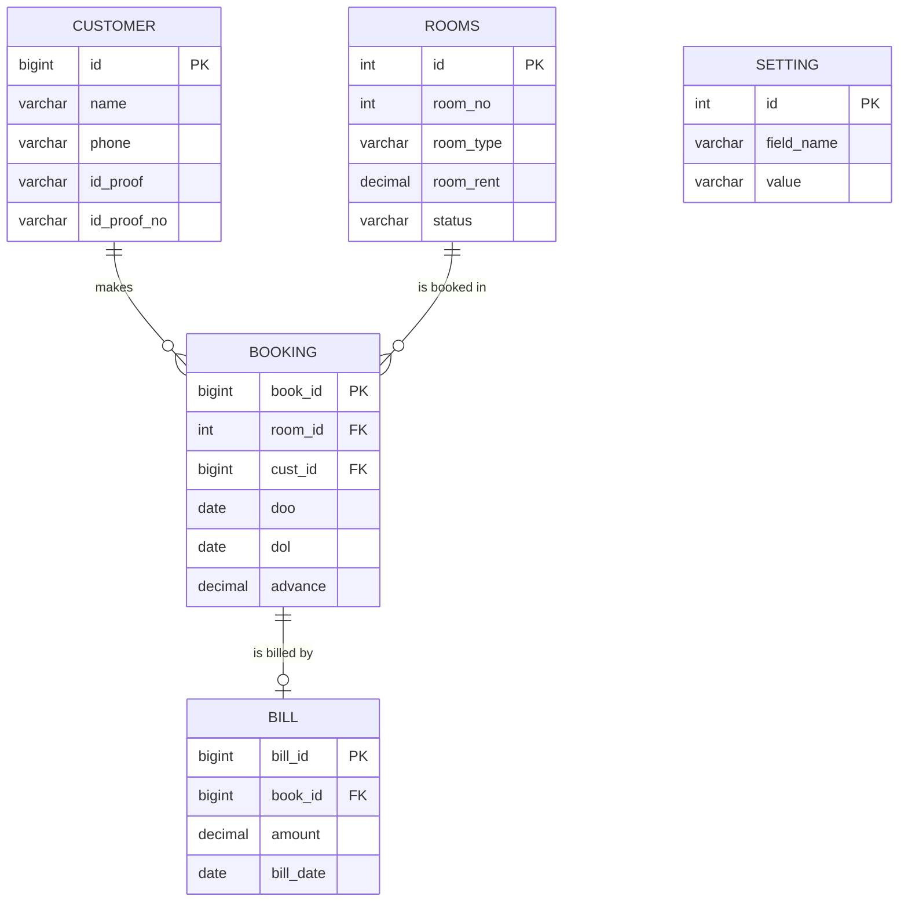

# Hotel Management System

A console-based hotel management application written in **Python** with a **MySQL** database. It handles rooms, customers, bookings (check-in), billing (check-out) and collection reports.

> Originally built as my Class 12 CBSE Computer Science (083) project at Kendriya Vidyalaya Mau (session 2021-22), then cleaned up and extended for GitHub.

## Features

- **Rooms** - add rooms, change type / rent / bed type / status (free, occupied, renovation)
- **Customers** - add and edit guest details (ID proof, number of males, females, children)
- **Booking** - check a guest into a free room with an advance payment
- **Billing** - calculates days stayed, rent, GST, service tax and advance, then frees the room and saves the bill
- **Search** - find rooms, current bookings, customers (by name, address, phone, email, ID) and bills
- **Reports** - room status, current guests, today's collection, monthly collection
- **Settings** - hotel name, address, phone, email, GST % and service tax %, stored in the database

## Tech stack

| Part | Technology |
|------|-----------|
| Language | Python 3.8+ |
| Database | MySQL 5.7+ / 8.x (MariaDB also works) |
| Driver | `mysql-connector-python` |

## Project structure

```
hotel-management-system/
├── hotel_management_system.py   # the application
├── database/
│   └── hotel.sql                # schema + sample data
├── docs/
│   ├── project_report.pdf       # original school project report
│   └── screenshots/             # add your screenshots here
├── requirements.txt
├── LICENSE
└── README.md
```

## Getting started

### 1. Prerequisites

- Python 3.8 or newer
- MySQL Server running on your machine

### 2. Clone and install

```bash
git clone https://github.com/<your-username>/hotel-management-system.git
cd hotel-management-system
pip install -r requirements.txt
```

### 3. Create the database

```bash
mysql -u root -p < database/hotel.sql
```

This creates the `hotel` database, all tables and a few sample rooms and customers. It is safe to run more than once.

### 4. Configure the connection

The password is **not** stored in the code. Either set environment variables, or just run the program and it will ask for the password.

| Variable | Default |
|----------|---------|
| `HMS_DB_HOST` | `localhost` |
| `HMS_DB_USER` | `root` |
| `HMS_DB_PASSWORD` | *(asked at start-up)* |
| `HMS_DB_NAME` | `hotel` |

```bash
# Linux / macOS
export HMS_DB_PASSWORD="your_password"

# Windows (PowerShell)
$env:HMS_DB_PASSWORD="your_password"
```

### 5. Run

```bash
python hotel_management_system.py
```

## Database design



`doo` = date of occupancy (check-in), `dol` = date of leaving (check-out; `NULL` while the guest is still staying).

## How billing works

```
days     = max(check-out date - check-in date, 1)
amount   = days x room rent
payable  = amount - advance + amount x GST% / 100 + amount x service tax% / 100
```

## What changed from the original school version

- Database password removed from the source; configured through environment variables
- All SQL queries are now parameterized (the original built SQL by joining strings, which allowed SQL injection)
- Changes are committed to the database, and booking/billing run as one transaction
- Added the missing *Today's collection* and *Monthly collection* reports
- Fixed room ID vs room number mix-ups, wrong columns in *Room Status* search, and crashes on invalid input
- Schema now has foreign keys and `DECIMAL` money columns

## Possible future improvements

- Login with staff accounts and hashed passwords
- Room-service orders and checkout invoice export (PDF)
- A GUI (Tkinter) or web front end (Flask / Django)
- Unit tests and a Docker Compose file for MySQL

## Author

**Adarsh Kumar Pandey** - B.Tech CSE (AI/ML), JSS Academy of Technical Education, Noida

## License

Released under the [MIT License](LICENSE).
